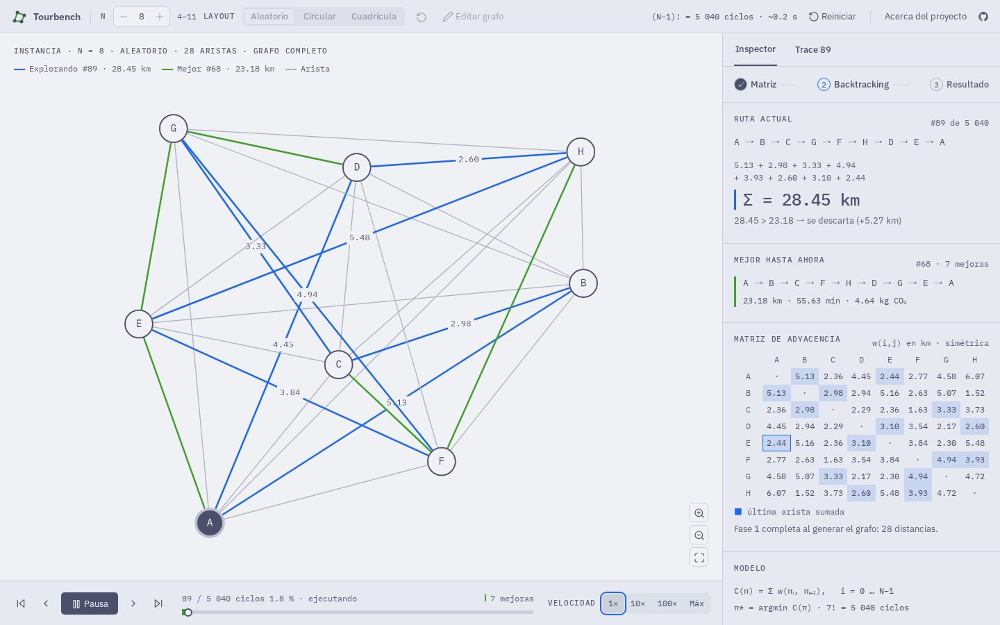
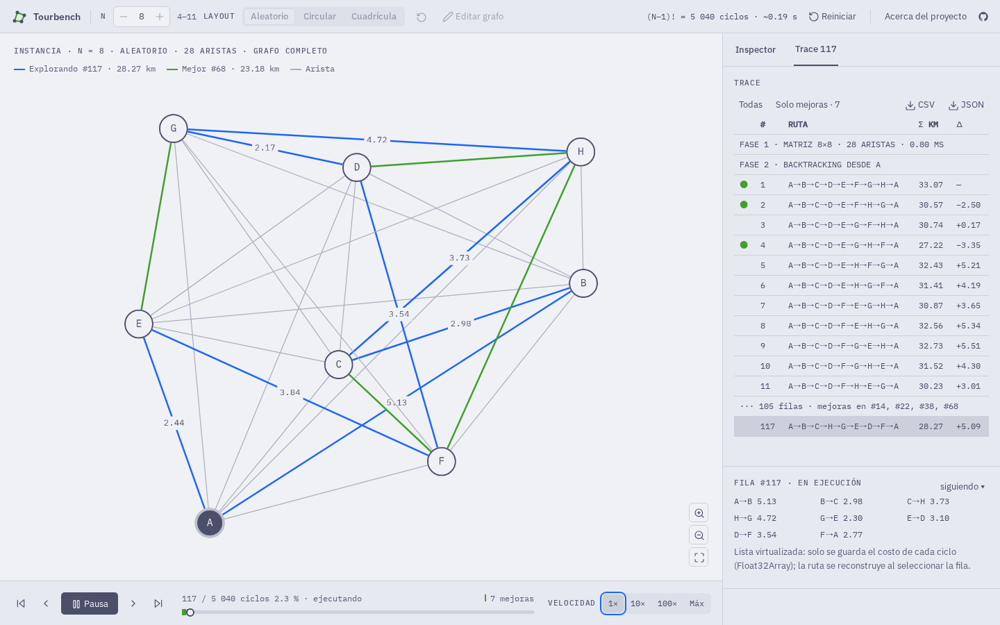
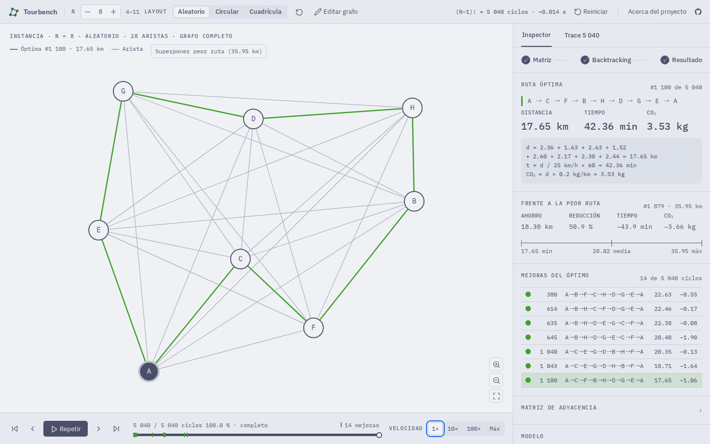
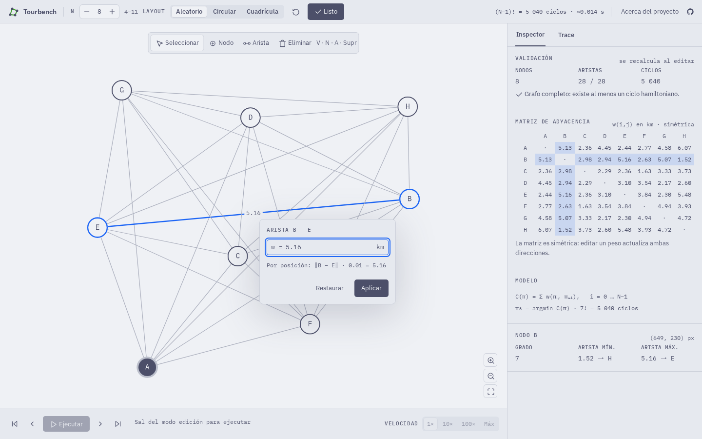
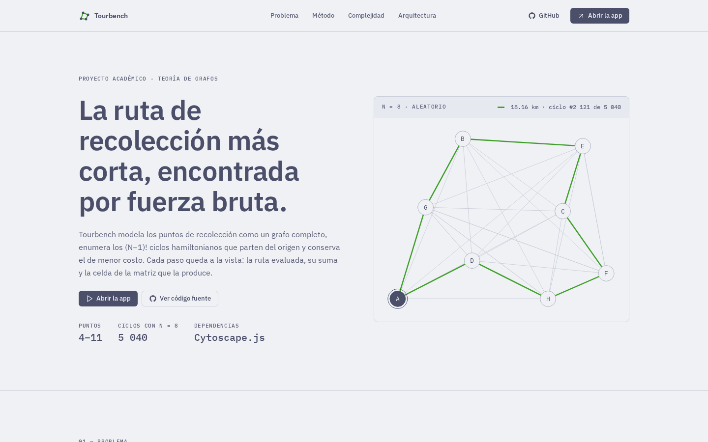
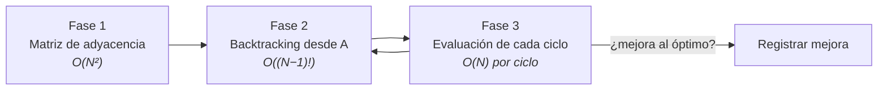
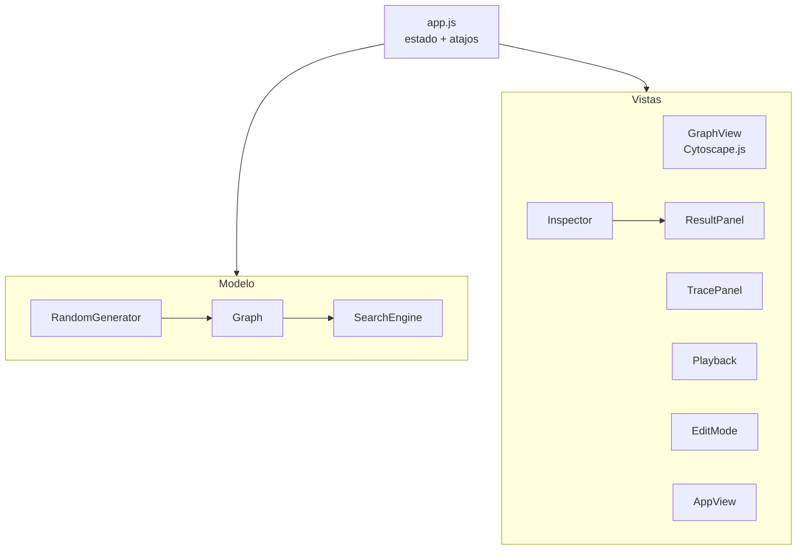

<div align="center">


# Tourbench

**Búsqueda exhaustiva del problema del agente viajero (TSP), paso a paso.**

Enumera todos los ciclos hamiltonianos de un grafo completo y muestra en vivo la ruta evaluada, su suma, la mejor encontrada y la celda de la matriz que la produce.

[](https://tourbench.jahattrinidad.com)
[](LICENSE)


[**Abrir la app →**](https://tourbench.jahattrinidad.com/app) · [Página del proyecto](https://tourbench.jahattrinidad.com) · [Documentación técnica](DOCUMENTATION.md)



</div>

---

## Qué es

Tourbench es un banco de pruebas visual del TSP resuelto **por fuerza bruta**. No usa heurísticas: con N puntos recorre los (N−1)! ciclos que parten del origen y se queda con el de menor costo. Es un proyecto académico de teoría de grafos cuyo objetivo es que el costo factorial se **vea**, no solo que se explique.

> [!NOTE]
> La app necesita al menos **1024 px** de ancho. En pantallas más chicas muestra un aviso con enlace a la página del proyecto.

## Capturas

| Ejecución (Inspector)                                                                    | Trace                                                                           |
| ---------------------------------------------------------------------------------------- | ------------------------------------------------------------------------------- |
|                       |      |
| **Resultado**                                                                            | **Edición del grafo**                                                           |
|  |  |

<details>
<summary>Página del proyecto</summary>



</details>

## Funcionalidades

| Área              | Qué hace                                                                                                 |
| ----------------- | -------------------------------------------------------------------------------------------------------- |
| **Instancia**     | N entre 4 y 11, layouts aleatorio, circular y cuadrícula, regenerar con un clic.                         |
| **Inspector**     | Ruta actual con su suma parcial, mejor ruta hasta el momento, matriz con las aristas activas resaltadas. |
| **Trace**         | Tabla virtualizada de todos los ciclos evaluados, filtro "solo mejoras" y exportación a CSV / JSON.      |
| **Resultado**     | Ruta óptima, distancia, tiempo y CO₂, fórmulas con los valores reales y comparación con la peor ruta.    |
| **Reproducción**  | Ejecutar, pausar, avanzar ciclo a ciclo e ir al final; velocidades 1×, 10×, 100× y Máx.                  |
| **Edición**       | Mover nodos y cambiar pesos de aristas; valida si el grafo todavía tiene un ciclo hamiltoniano.          |
| **Accesibilidad** | Atajos de teclado, nodos recorribles con Tab, anuncios por `aria-live` y `prefers-reduced-motion`.       |

### Atajos de teclado

| Tecla              | Acción                                |
| ------------------ | ------------------------------------- |
| `Espacio`          | Ejecutar / pausar                     |
| `←` `→`            | Ciclo anterior / siguiente (en pausa) |
| `Inicio` `Fin`     | Primer ciclo / saltar al resultado    |
| `1` `2`            | Pestañas Inspector / Trace            |
| `E`                | Entrar o salir del modo edición       |
| `V` `N` `A` `Supr` | Herramientas de edición               |
| `Tab`              | Recorrer los nodos del grafo          |

## Cómo funciona



1. **Matriz.** Se precalcula `w(i, j) = ‖pᵢ − pⱼ‖ · 0.01` km para consultar cualquier distancia en O(1).
2. **Backtracking.** `SearchEngine` enumera las permutaciones de los nodos restantes en orden lexicográfico **sin guardar las rutas**: solo un `Float32Array` con el costo de cada ciclo. La ruta de cualquier fila se reconstruye a partir de su índice.
3. **Evaluación.** Cada ciclo suma sus N aristas; si mejora al óptimo actual, se registra.

### El muro factorial

| N   | Ciclos (N−1)! | Tiempo estimado* | En la app         |
| --- | ------------: | ---------------: | ----------------- |
| 8   |         5 040 |          ~0.05 s | Valor por defecto |
| 10  |       362 880 |             ~4 s | Pide confirmación |
| 11  |     3 628 800 |            ~36 s | Límite            |
| 12  |    39 916 800 |           ~7 min | Fuera de alcance  |
| 13  |   479 001 600 |           ~1.3 h | Fuera de alcance  |

<sub>* Estimación a ~10⁵ ciclos/s. La app mide la tasa real durante la ejecución.</sub>

### Métricas derivadas

| Métrica   | Fórmula                 | Supuesto                        |
| --------- | ----------------------- | ------------------------------- |
| Tiempo    | `t = d / 25 × 60` min   | 25 km/h, velocidad media urbana |
| Emisiones | `CO₂ = d × 0.2` kg      | 0.2 kg de CO₂ por km            |
| Ahorro    | `Δ = C(π_peor) − C(π*)` | Comparación contra la peor ruta |

## Arquitectura

Todo corre en el navegador, sin backend ni build. Cada módulo es una clase global cargada con `<script>`; los algoritmos no conocen la interfaz.



El detalle de cada módulo está en [DOCUMENTATION.md](DOCUMENTATION.md).

## Correr localmente

```bash
git clone https://github.com/trinity-bytes/green-circuit.git tourbench
cd tourbench
python3 -m http.server 8000   # o cualquier servidor estático
```

Abre `http://localhost:8000` (página del proyecto) o `http://localhost:8000/app.html` (la app). Agrega `?seed=7` a la URL de la app para obtener siempre la misma instancia aleatoria.

### Pruebas

```bash
npm test   # node --test, sin dependencias
```

Cubren el motor de búsqueda: cantidad de ciclos, óptimo frente a una implementación de referencia, reconstrucción de rutas, grafos sin ciclo hamiltoniano, métricas y la columna Δ del Trace.

## Despliegue

El sitio es estático: no necesita build. En **Cloudflare Pages**:

| Ajuste                 | Valor                         |
| ---------------------- | ----------------------------- |
| Framework preset       | `None`                        |
| Build command          | _(vacío)_                     |
| Build output directory | `/`                           |
| Dominio personalizado  | `tourbench.jahattrinidad.com` |

Pages sirve `index.html` en `/` y `app.html` en `/app`.

## Estructura

```text
├── index.html              # Página del proyecto
├── app.html                # La app
├── assets/                 # Sprite de íconos, favicon e imagen social
├── docs/screenshots/       # Capturas del README
├── src/
│   ├── js/                 # Modelo, motor de búsqueda y vistas
│   └── styles/             # tokens.css, app.css, landing.css, about.css
└── test/                   # Pruebas del motor (node --test)
```

## Aviso académico

Este proyecto se publica con fines académicos y de referencia. Puedes inspirarte en él y aprender de él, pero **no me hago responsable por el plagio total o parcial en entregas con calificación**. Si reutilizas partes del proyecto en trabajos evaluados, hazlo bajo tu propio criterio y respetando las políticas de tu institución.

## Licencia

[MIT](LICENSE) © 2025 [Jahat Trinidad](https://jahattrinidad.com) · [@trinity-bytes](https://github.com/trinity-bytes)
